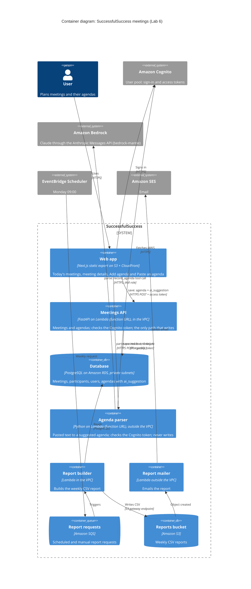

# Container diagram (C4, level 2)

The meetings app on AWS after Lab 6. New in Lab 6: the **agenda parser**
function, **Amazon Bedrock**, and the two flows of Paste an agenda:

- **parse**: browser → agenda parser → Bedrock (Claude). Read-only: it returns
  a suggestion as JSON and writes nothing.
- **save**: browser → meetings API → database. The same validated path as every
  other write, which also stores the AI suggestion next to the saved agenda.

